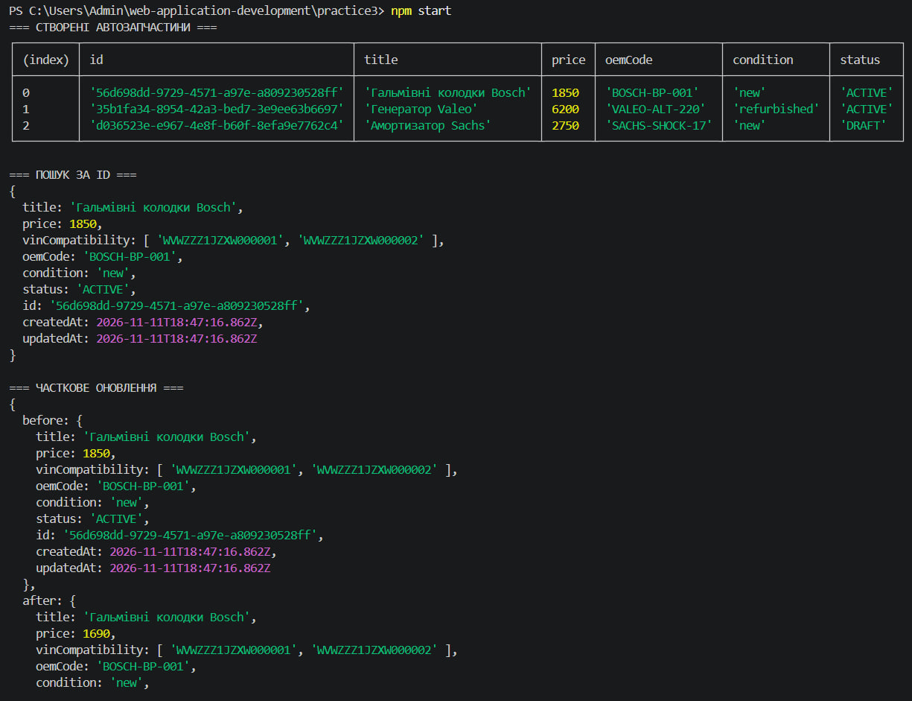
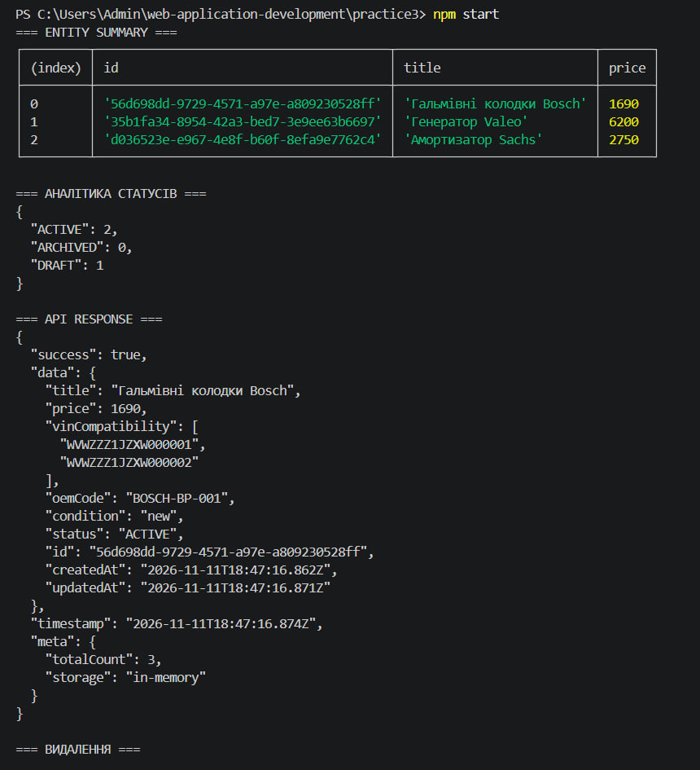
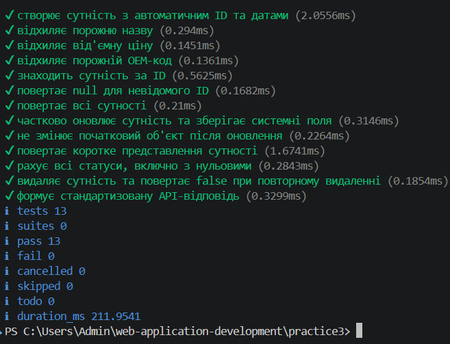

# Практична робота № 3

**Тема:** Узагальнення, декоратори та утиліти типів TypeScript

**Варіант № 7 — автозапчастини**

## Мета роботи

- Навчитися працювати з узагальненими типами та створювати generic-репозиторії.
- Закріпити використання інтерфейсів і обмежень generic-параметрів.
- Ознайомитися з Utility Types для створення DTO та коротких представлень сутностей.
- Реалізувати зберігання, пошук, оновлення й видалення даних, а також підрахунок записів за статусами.

## Хід виконання роботи

### Рівень 1. Базовий: структура проєкту та Generic In-Memory Repository

| **Компонент** | **Призначення** |
| --- | --- |
| `BaseEntity` | Базові поля сутності: `id: string`, `createdAt: Date`, `updatedAt: Date` |
| `ApiResponse<TData>` | Типізована відповідь із полями `success`, `data`, `timestamp` та необов’язковим `meta` |
| `IRepository<T extends BaseEntity>` | Інтерфейс із методами `create`, `findById`, `findAll`, `update`, `deleteById` |
| `InMemoryRepository<T extends BaseEntity>` | Узагальнений репозиторій, який зберігає сутності у внутрішній `Map<string, T>` |

`create` перевіряє, щоб ідентифікатор не був порожнім і не повторював уже наявний. `findById` повертає `null`, якщо запис не знайдено, а `deleteById` повертає результат видалення у вигляді `boolean`.

Під час створення, отримання та оновлення записів використовується `structuredClone`. Завдяки цьому зміни копії об’єкта не змінюють дані, які зберігаються в репозиторії.

### Рівень 2. Utility Types та робота з автозапчастинами

`AutoPartEntity` розширює `BaseEntity` полями `title`, `price`, `vinCompatibility`, `oemCode`, `condition` і `status`. Для стану деталі передбачено два значення: `new` та `refurbished`.

Строковий enum `EntityStatus` містить `Active = "ACTIVE"`, `Archived = "ARCHIVED"` і `Draft = "DRAFT"`.

| **Тип** | **Реалізація та використання** |
| --- | --- |
| `CreateDto<T>` | `Omit<T, keyof BaseEntity>` прибирає системні поля `id`, `createdAt`, `updatedAt` під час створення |
| `UpdateDto<T>` | `Partial<CreateDto<T>>` дозволяє передавати для оновлення лише потрібні поля |
| `EntitySummary<T>` | `Pick<T, "id" \| "title" \| "price">` формує коротке представлення автозапчастини |
| `EntityAnalytics<T>` | `Record<T["status"], number>` зберігає кількість записів для кожного статусу |

Обмеження generic-параметрів задають необхідні поля для сутностей і DTO. Під час створення автозапчастини сервіс формує UUID та часові мітки, а також перевіряє назву, ціну, OEM-код і VIN-сумісність.

Метод `update(id, patch)` повертає оновлену сутність або `null`, якщо запису немає. Він змінює передані поля, оновлює `updatedAt` та зберігає початкові `id` і `createdAt`.

`EntitySummary` задає тип короткого представлення, а метод `summarize` повертає лише `id`, `title` і `price`. Аналітика враховує всі три статуси, навіть якщо для одного з них кількість записів дорівнює нулю.

Для роботи з автозапчастинами створено `AutoPartService`. Він об’єднує створення, перевірку, пошук, оновлення та видалення записів, а також формування короткого представлення, статистики й об’єкта `ApiResponse`.

У `tsconfig.json` увімкнено суворий режим TypeScript, зокрема `strict`, `noImplicitAny`, `strictNullChecks` і `noUncheckedIndexedAccess`. Декоратори та завдання третього рівня не реалізовувалися.

## Демонстраційний сценарій

1. Створити три сутності `AutoPartEntity`: гальмівні колодки Bosch за `1850`, генератор Valeo за `6200` та амортизатор Sachs за `2750`.
2. Знайти гальмівні колодки за ідентифікатором і вивести список усіх трьох записів.
3. Оновити ціну гальмівних колодок із `1850` до `1690`, перевірити збереження `id` та `createdAt`.
4. Вивести короткі представлення автозапчастин, які містять лише `id`, `title` і `price`.
5. Показати статистику за статусами `ACTIVE`, `ARCHIVED` і `DRAFT`.
6. Сформувати `ApiResponse<AutoPartEntity>` з часовою міткою та метаданими про кількість записів і тип сховища.
7. Видалити амортизатор, перевірити результат видалення та кількість записів, що залишилися в репозиторії.

## Структура

| **Шлях** | **Призначення** |
| --- | --- |
| `src/types/` | Базова сутність, модель автозапчастини, статуси, API-відповідь і DTO |
| `src/repositories/` | Інтерфейс та узагальнений репозиторій для роботи з даними |
| `src/services/` | Сервіс для створення, перевірки й опрацювання автозапчастин |
| `src/index.ts` | Послідовна демонстрація операцій у консолі |
| `tests/` | Перевірки створення, пошуку, оновлення, видалення та аналітики |

## Скріни

### 1 — Створення, пошук і часткове оновлення

Команда `npm start` створює три автозапчастини. У таблиці `СТВОРЕНІ АВТОЗАПЧАСТИНИ` видно їхні ідентифікатори, назви, ціни, OEM-коди, стан і статус.

Далі показано результат пошуку гальмівних колодок за ID та часткове оновлення ціни з `1850` до `1690`. У блоці оновлення мають бути видні початковий і новий об’єкти, а також перевірки збереження `id` та `createdAt`.

### 2 — Короткі представлення, аналітика, API-відповідь і видалення

У блоці `ENTITY SUMMARY` відображаються лише `id`, `title` і `price`. Аналітика показує кількість записів за статусами: `ACTIVE: 2`, `ARCHIVED: 0`, `DRAFT: 1`.

У блоці `API RESPONSE` показано стандартизовану відповідь із `success`, даними автозапчастини, часовою міткою та метаданими. Після цього програма видаляє амортизатор, показує результат операції та кількість записів, що залишилися.

### 3 — Перевірка компіляції та тестів

Команда `npm run build` перевіряє TypeScript без створення JavaScript-файлів. Команда `npm test` запускає автоматичні тести для створення автозапчастин, перевірки даних, пошуку, оновлення, короткого представлення, аналітики, видалення та API-відповіді.

## Висновок

Під час практичної роботи створено застосунок для обліку автозапчастин. Реалізовано базову сутність, узагальнений репозиторій, сервіс і типи для створення та оновлення записів. Також додано коротке представлення сутностей, підрахунок статусів і формування API-відповіді. Виконано перший і другий рівні роботи.
