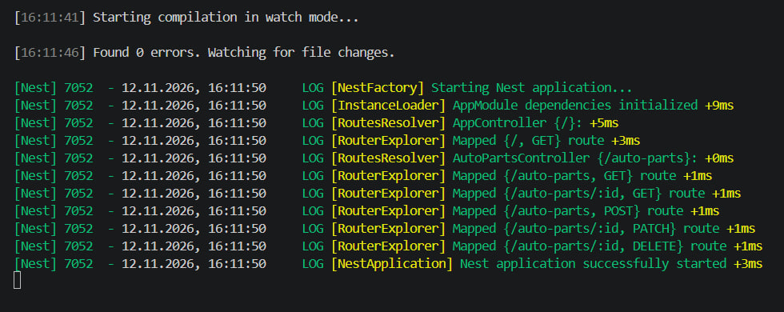
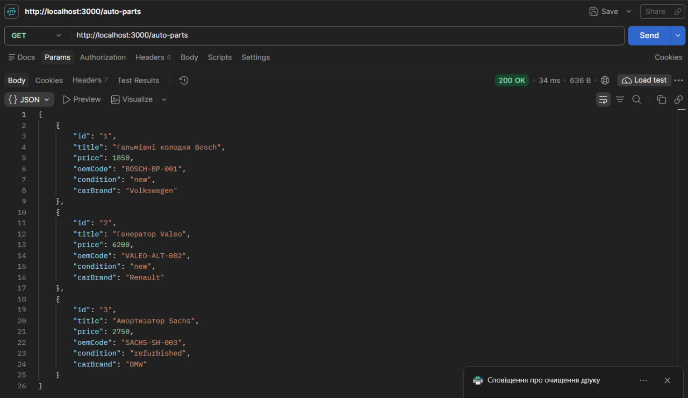
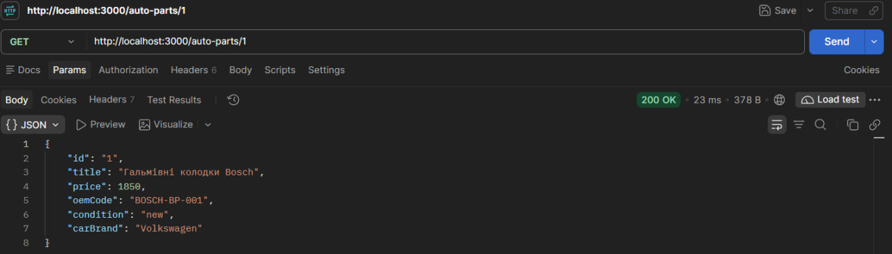
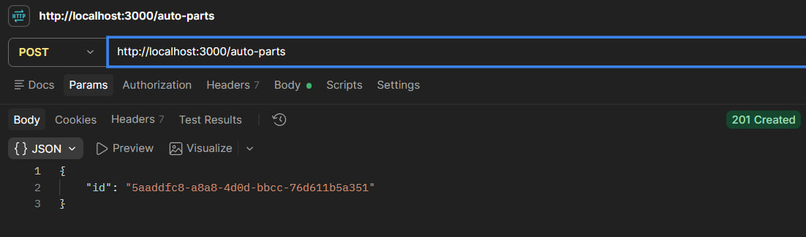
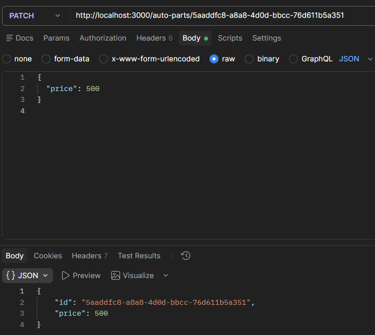
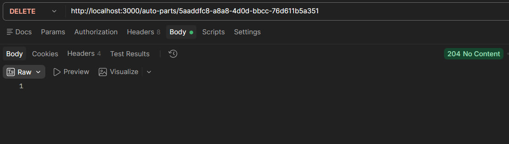
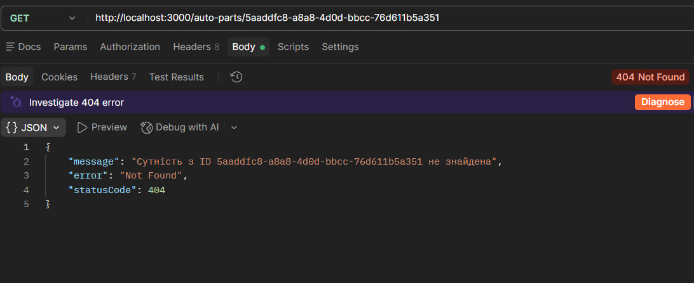

# Практична робота № 4

**Тема:** Розроблення REST-ендпоінтів засобами NestJS

**Варіант № 7 — автозапчастини**

## Мета роботи

- Ознайомитися з архітектурою NestJS, модулями, контролерами та сервісами.
- Навчитися створювати REST API та працювати з HTTP-запитами.
- Закріпити використання DTO для опису структури даних.
- Реалізувати CRUD-операції з використанням in-memory сховища.
- Опанувати Dependency Injection та обробку HTTP-виключень.

## Хід виконання роботи

### Рівень 1. Базовий: створення NestJS-проєкту та оголошення ендпоінтів

Створено проєкт `practice4` за допомогою NestJS. Для предметної області використано ресурс `/auto-parts`, який відповідає варіанту № 7.

Для автозапчастини визначено такі поля:

| Поле | Призначення |
|---|---|
| `id` | Унікальний ідентифікатор |
| `title` | Назва автозапчастини |
| `price` | Ціна |
| `oemCode` | OEM-код деталі |
| `condition` | Стан автозапчастини |
| `carBrand` | Марка автомобіля |

Створено клас `AutoPart`, DTO `CreateAutoPartDto` та `UpdateAutoPartDto`. У контролері `AutoPartsController` оголошено маршрути для отримання списку, отримання окремого запису та створення автозапчастини.

### Рівень 2. Повний REST CRUD, HTTP-статуси та In-Memory Service

Створено `AutoPartsService`, який зберігає дані у внутрішньому масиві. Для початкового заповнення додано три тестові записи: гальмівні колодки Bosch, генератор Valeo та амортизатор Sachs.

У сервісі реалізовано методи:

| Метод | Призначення |
|---|---|
| `findAll()` | Повертає всі автозапчастини |
| `findOne(id)` | Знаходить запис за ідентифікатором |
| `create(dto)` | Створює нову автозапчастину з UUID |
| `update(id, dto)` | Оновлює передані поля запису |
| `remove(id)` | Видаляє запис |

Сервіс підключено до контролера через Dependency Injection. Якщо запис із заданим ідентифікатором відсутній, генерується `NotFoundException` зі статусом `404 Not Found`.

Для створення запису використовується статус `201 Created`, а для видалення — `204 No Content`.

## Маршрути API

| HTTP-метод | Маршрут | Призначення | Статус |
|---|---|---|---|
| GET | `/auto-parts` | Отримати всі автозапчастини | 200 |
| GET | `/auto-parts/:id` | Отримати автозапчастину за ID | 200 або 404 |
| POST | `/auto-parts` | Створити автозапчастину | 201 |
| PATCH | `/auto-parts/:id` | Оновити автозапчастину | 200 або 404 |
| DELETE | `/auto-parts/:id` | Видалити автозапчастину | 204 або 404 |

## Перевірка роботи застосунку

Для перевірки працездатності REST API використано Postman. Виконано запити для отримання, створення, оновлення та видалення автозапчастин, а також перевірено обробку запиту до неіснуючого запису.

### Запуск NestJS

На скріншоті показано успішний запуск NestJS, компіляцію без помилок та реєстрацію всіх маршрутів контролера `AutoPartsController`.

### Тестування API в Postman

**1. Отримання всіх автозапчастин (GET)**

Виконано GET-запит до `/auto-parts`, який успішно повернув список трьох початкових автозапчастин зі статусом `200 OK`.

**2. Отримання автозапчастини за ID (GET)**

Виконано GET-запит до `/auto-parts/1`, який повернув інформацію про гальмівні колодки Bosch зі статусом `200 OK`.

**3. Створення автозапчастини (POST)**

Виконано POST-запит для створення масляного фільтра Volkswagen, у результаті якого отримано новий запис з унікальним UUID та статусом `201 Created`.

**4. Оновлення автозапчастини (PATCH)**

Виконано PATCH-запит для зміни ціни створеної автозапчастини на 500, сервер повернув статус `200 OK`.

**5. Видалення автозапчастини (DELETE)**

Виконано DELETE-запит для видалення створеної автозапчастини, сервер успішно повернув статус `204 No Content`.

**6. Перевірка неіснуючої автозапчастини (GET)**

Повторно виконано GET-запит за ідентифікатором видаленого запису, у відповідь сервер повернув `404 Not Found`, що підтверджує правильну обробку відсутніх даних.

## Висновок

Під час практичної роботи створено REST API для керування автозапчастинами засобами NestJS. Реалізовано структуру проєкту, DTO, контролер і сервіс із використанням Dependency Injection. Додано операції створення, отримання, оновлення та видалення записів, а також обробку ситуацій, коли потрібна автозапчастина не знайдена. Роботу API перевірено за допомогою Postman. Виконано перший і другий рівні практичної роботи.
