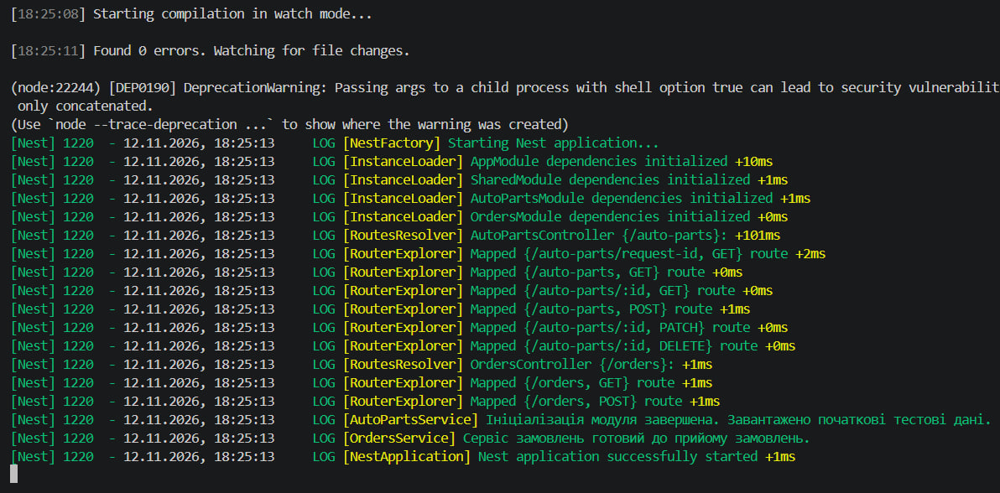
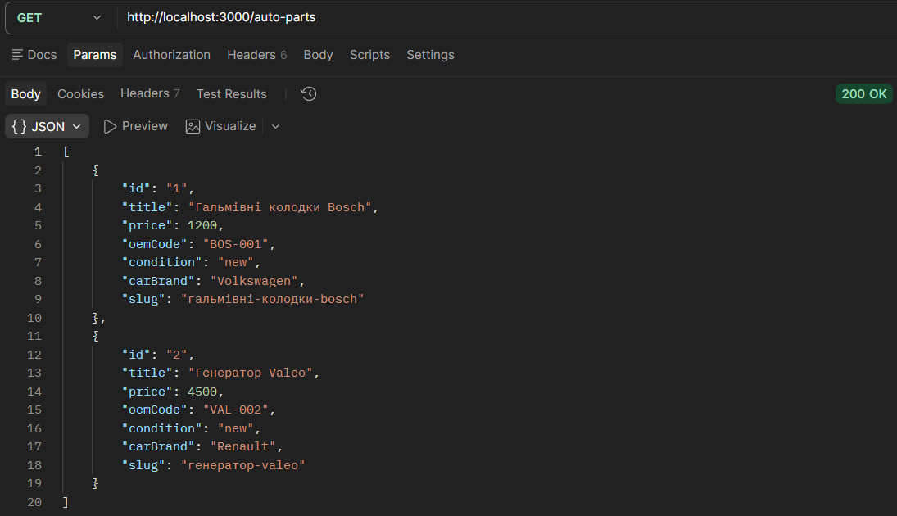
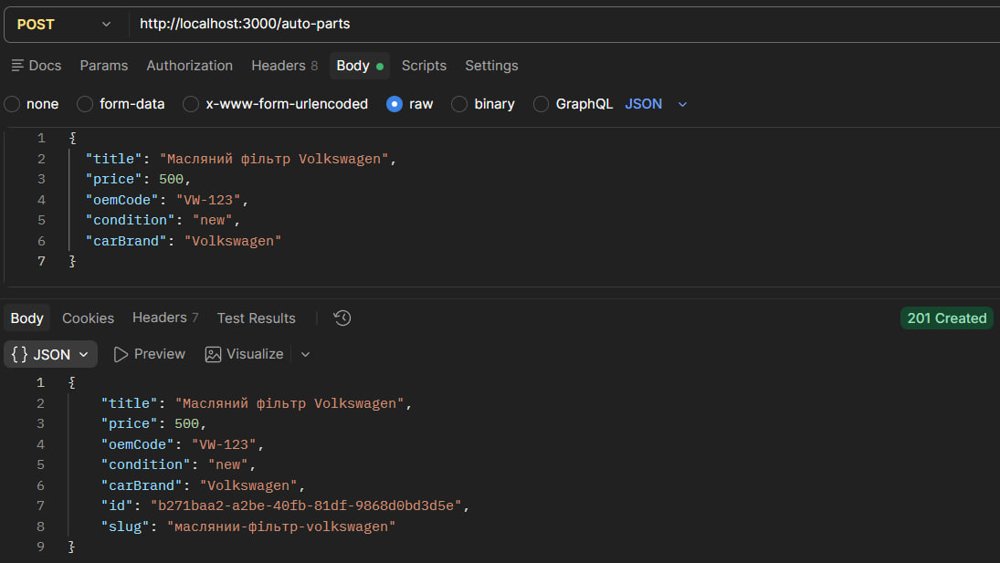
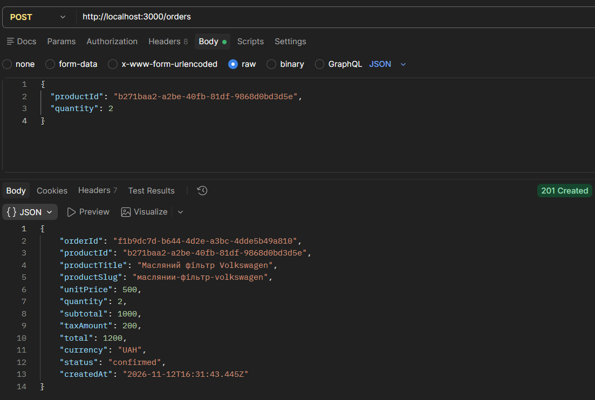
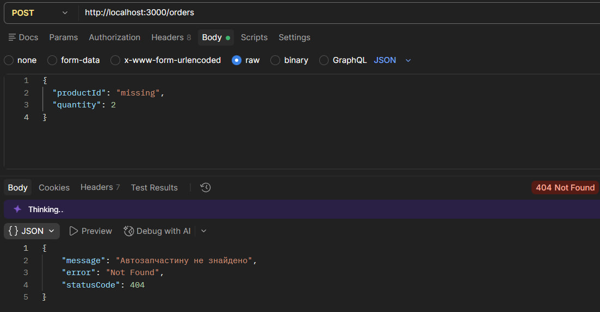
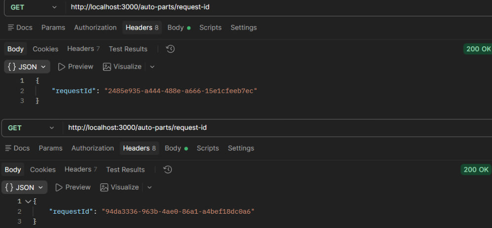
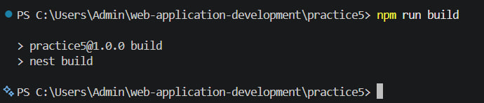

# Практична робота № 5

**Тема:** Модульна архітектура та ін’єкція залежностей у NestJS

**Варіант № 7 — автозапчастини**

## Мета роботи

- Ознайомитися з модульною архітектурою NestJS та принципами поділу застосунку на функціональні й спільні модулі.
- Навчитися організовувати взаємодію між модулями через Dependency Injection.
- Реалізувати кастомні провайдери за допомогою `useValue` та `useFactory`.
- Ознайомитися з `OnModuleInit` та `Scope.REQUEST`.
- Перевірити роботу REST API за допомогою HTTP-запитів.

## Хід виконання роботи

### Рівень 1. Базовий: створення Feature Module та Shared Module

Створено проєкт `practice5` на NestJS для магазину автозапчастин. Реалізовано `AutoPartsModule`, що містить `AutoPartsController` та `AutoPartsService`. Модулі підключаються до кореневого `AppModule` через `imports`.

Створено `SharedModule` із сервісом `SlugService`, який автоматично генерує `slug` із назви автозапчастини. `AutoPartsService` отримує цей сервіс через конструктор за допомогою Dependency Injection.

Сутність автозапчастини містить `id`, `title`, `slug`, `price`, `oemCode`, `condition` і `carBrand`. Реалізовано CRUD-операції з використанням in-memory сховища.

### Рівень 2. Міжмодульна взаємодія та Custom Providers

Створено `OrdersModule`, `OrdersController` та `OrdersService`. Для оформлення замовлення `OrdersService` отримує `AutoPartsService` через Dependency Injection, перевіряє наявність товару та використовує його актуальну ціну.

У `SharedModule` реалізовано два кастомні провайдери:

| Провайдер | Призначення |
|---|---|
| `STORE_CONFIG` (`useValue`) | Налаштування магазину, валюта `UAH` і ставка податку 20% |
| `FEE_CALCULATOR` (`useFactory`) | Обчислення податку для замовлення |

Під час оформлення замовлення розраховуються `subtotal`, `taxAmount` та `total`. Якщо автозапчастину не знайдено, повертається `404 Not Found`. Замовлення зберігаються в оперативній пам’яті.

### Рівень 3. Lifecycle Hooks, Scope та комплексне тестування

У `AutoPartsService` реалізовано `OnModuleInit`. Під час запуску додаються дві початкові автозапчастини — гальмівні колодки Bosch та генератор Valeo — із згенерованими `slug`. У `OrdersService` використано `OnModuleInit` для повідомлення про готовність сервісу.

Для перевірки області видимості створено `RequestIdService` із `Scope.REQUEST`. Маршрут `GET /auto-parts/request-id` дозволяє порівняти ідентифікатори, отримані під час різних HTTP-запитів.

Підготовлено HTTP-запити для перевірки створення автозапчастин, оформлення замовлень, обробки помилок та взаємодії модулів.

## Маршрути API

| Метод | Маршрут | Призначення | Статус |
|---|---|---|---|
| GET | `/auto-parts` | Отримати всі автозапчастини | 200 |
| GET | `/auto-parts/:id` | Отримати автозапчастину за ID | 200 або 404 |
| POST | `/auto-parts` | Створити автозапчастину та згенерувати `slug` | 201 |
| PATCH | `/auto-parts/:id` | Оновити автозапчастину | 200 або 404 |
| DELETE | `/auto-parts/:id` | Видалити автозапчастину | 204 або 404 |
| POST | `/orders` | Створити замовлення з податком | 201 або 404 |
| GET | `/orders` | Отримати список замовлень | 200 |
| GET | `/auto-parts/request-id` | Перевірити `Scope.REQUEST` | 200 |


Сервер доступний за адресою `http://localhost:3000`.

## Тестування API

**1. Отримання автозапчастин:** `GET http://localhost:3000/auto-parts` — очікується `200 OK` і список із двома початковими товарами.

**2. Створення автозапчастини:** `POST http://localhost:3000/auto-parts`

```json
{
  "title": "Масляний фільтр Volkswagen",
  "price": 500,
  "oemCode": "VW-123",
  "condition": "new",
  "carBrand": "Volkswagen"
}
```

Очікується `201 Created`, новий `id` і автоматично сформований `slug`.

**3. Створення замовлення:** `POST http://localhost:3000/orders`

```json
{
  "productId": "ID_СТВОРЕНОЇ_АВТОЗАПЧАСТИНИ",
  "quantity": 2
}
```

Для ціни 500 грн очікуються `subtotal: 1000`, `taxAmount: 200`, `total: 1200`, `currency: "UAH"`.

**4. Перевірка помилки:** повторити `POST /orders` із `productId: "missing"`. Очікується `404 Not Found`.

**5. Список замовлень:** `GET http://localhost:3000/orders` — очікується `200 OK` і раніше створене замовлення.

**6. Перевірка Scope.REQUEST:** двічі виконати `GET http://localhost:3000/auto-parts/request-id` і порівняти значення `requestId`.

## Скріншоти

### 1 — Запуск модулів і Lifecycle Hooks

У терміналі VS Code показано запуск NestJS без помилок компіляції (`Found 0 errors`), ініціалізацію `SharedModule`, `AutoPartsModule` та `OrdersModule`, а також повідомлення `AutoPartsService` і `OrdersService` про готовність до роботи.



### 2 — Початкові автозапчастини зі slug

Запит `GET /auto-parts` повертає `200 OK` і дві початкові автозапчастини — гальмівні колодки Bosch та генератор Valeo. У відповіді видно їхні ідентифікатори, назви, ціни та автоматично сформовані `slug`.



### 3 — Створення автозапчастини через SlugService

POST-запит до `/auto-parts` створює масляний фільтр Volkswagen із ціною 500 грн та OEM-кодом `VW-123`. У відповіді `201 Created` видно новий `id` і поле `slug`, яке сформовано автоматично без передавання клієнтом.



### 4 — Міжмодульне створення замовлення та розрахунок податку

POST-запит до `/orders` передає `productId` створеної автозапчастини та кількість `2`. `OrdersService` отримує ціну з каталогу: вартість товарів становить 1000 грн, податок 20% — 200 грн, загальна сума — 1200 UAH. У відповіді видно `subtotal`, `taxAmount` і `total`.



### 5 — Відсутній товар і список замовлень

Спроба створити замовлення з `productId: "missing"` повертає `404 Not Found`. Наступний запит `GET /orders` показує раніше оформлене замовлення, тобто помилкова спроба не додає новий запис.



### 6 — Перевірка Scope.REQUEST

Два окремі запити до `GET /auto-parts/request-id` повертають різні значення `requestId`. Це демонструє створення нового екземпляра `RequestIdService` для кожного HTTP-запиту.



### 7 — Логи RequestIdService та перевірка компіляції

У терміналі показано повідомлення `RequestIdService` про створення екземплярів (якщо вони виводяться поточною реалізацією) та результати перевірки компіляції NestJS без помилок.



## Висновок

Під час практичної роботи розроблено модульний NestJS-застосунок для магазину автозапчастин. Створено `AutoPartsModule`, `OrdersModule` та `SharedModule`, реалізовано взаємодію через Dependency Injection, автоматичну генерацію `slug`, кастомні провайдери `useValue` і `useFactory`, розрахунок податку, початкове наповнення даних через `OnModuleInit` та перевірку `Scope.REQUEST`. Підготовлено HTTP-запити для тестування REST API.
